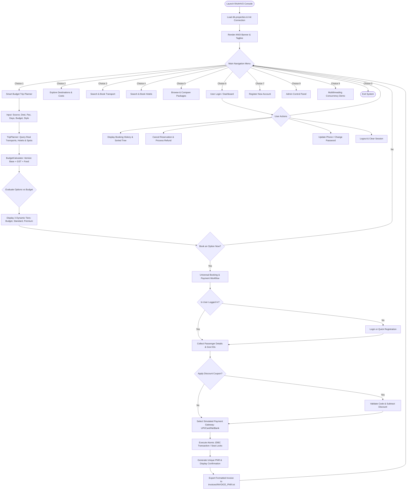

# RAAHVO - APPLICATION FLOWCHART & STATE MACHINE

## 1. System Navigation Flowchart



## 2. Smart Trip Planner Decision Logic
```mermaid
flowchart TD
    UserQuery[User inputs: City, Manali, 2 Travellers, 3 Days, Budget: ₹15,000] --> QueryDB[Query DB for routes, hotels, spots]
    QueryDB --> BuildBudget[Build Tier 1: Budget<br/>Volvo Bus + Solang Retreat + 2 Spots]
    QueryDB --> BuildStandard[Build Tier 2: Standard<br/>Vande Bharat + Himalayan Resort + 3 Spots]
    QueryDB --> BuildPremium[Build Tier 3: Premium<br/>Flight + Luxury Suite + All Spots]

    BuildBudget --> Check1{₹13,590 <= ₹15,000?}
    Check1 -->|True| MarkBudgetGreen[Mark Option 1: WITHIN BUDGET (+₹1,410 cushion)]
    BuildStandard --> Check2{₹24,145 <= ₹15,000?}
    Check2 -->|False| MarkStdRed[Mark Option 2: EXCEEDS BUDGET by ₹9,145]
    BuildPremium --> Check3{₹49,291 <= ₹15,000?}
    Check3 -->|False| MarkPremRed[Mark Option 3: EXCEEDS BUDGET by ₹34,291]

    MarkBudgetGreen --> Present[Present Side-by-Side Breakdown to User]
    MarkStdRed --> Present
    MarkPremRed --> Present
```
